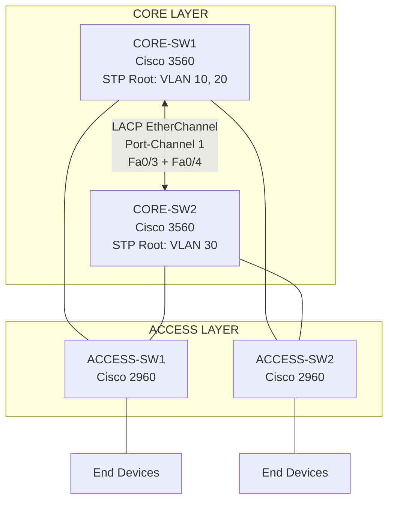

# Hilltop Guest House – Redundant Network Design

## Project Overview

This project demonstrates the design and implementation of a redundant enterprise network for Hilltop Guest House using Cisco Packet Tracer.

The network is designed with separate VLANs for Guest, Staff, and Management departments. It uses a redundant core switching architecture, EtherChannel, and Spanning Tree Protocol (STP) to improve network availability and prevent switching loops.

## 1. Network Topology

The network consists of:

- 2 Cisco Routers
- 2 Cisco Catalyst 3560 Multilayer Core Switches
- 2 Cisco Catalyst 2960 Access Switches
- 9 End Devices (PCs)
- Redundant connections between core and access switches
- EtherChannel links between core switches

### Logical Network Topology



*Note: This is a logical representation of the redundant switching architecture. Confirm all uplinks and device connections against the actual Packet Tracer topology before submission. Router connections are not illustrated here.*

## 2. VLAN Configuration

| VLAN ID | VLAN Name | Department |
|---|---|---|
| 10 | GUEST | Guest Network |
| 20 | STAFF | Staff Network |
| 30 | MANAGEMENT | Management Network |

## 3. IP Addressing and Gateway Plan

Base Network: `192.168.100.0/24`

| Department | VLAN | Network Address | Subnet Mask | Default Gateway | Usable IP Range | Broadcast |
|---|---:|---|---|---|---|---|
| Guest | 10 | 192.168.100.0/26 | 255.255.255.192 | 192.168.100.1 | 192.168.100.2 – 192.168.100.62 | 192.168.100.63 |
| Staff | 20 | 192.168.100.64/27 | 255.255.255.224 | 192.168.100.68 | 192.168.100.65 – 192.168.100.94 | 192.168.100.95 |
| Management | 30 | 192.168.100.96/28 | 255.255.255.240 | 192.168.100.98 | 192.168.100.97 – 192.168.100.110 | 192.168.100.111 |

## 4. Sample PC IP Configuration

The following IP addresses are visible in the network topology:

| Device | IP Address | Default Gateway | VLAN |
|---|---|---|---|
| PC0 | 192.168.100.2 | 192.168.100.1 | 10 |
| PC3 | 192.168.100.69 | 192.168.100.68 | 20 |
| PC8 | 192.168.100.101 | 192.168.100.98 | 30 |

## 5. Redundant Core Switching Architecture

Two multilayer switches are deployed as the core layer, with two access switches connected redundantly.

Key implementation features:

- Redundant links between core and access switches.
- Multiple paths for network availability.
- EtherChannel between core switches.
- VLAN trunking between switches.
- STP for Layer 2 loop prevention.

## 6. EtherChannel Configuration

LACP EtherChannel is implemented between the two core switches.

| Parameter | Configuration |
|---|---|
| Protocol | LACP |
| Port-Channel | Port-Channel 1 |
| Physical Interfaces | Fa0/3 and Fa0/4 |
| Purpose | Link aggregation and redundancy |

EtherChannel combines multiple physical connections into one logical connection, providing increased link capacity and redundancy.

If one physical member link fails, the remaining operational member continues forwarding traffic through the logical Port-Channel.

If the entire EtherChannel fails, STP can use an alternative available Layer 2 path, provided a redundant path exists and STP reconverges successfully.

## 7. Spanning Tree Protocol (STP)

PVST is implemented to prevent Layer 2 switching loops and manage redundant network paths.

### STP Root Bridge Design

| VLAN | Department | Root Bridge |
|---|---|---|
| 10 | Guest | Core-SW1 |
| 20 | Staff | Core-SW1 |
| 30 | Management | Core-SW2 |

The root bridge responsibilities are distributed between the two core switches to provide a balanced STP design across different VLANs.

- CORE-SW1 is configured as the Root Bridge for VLANs 10 and 20.
- CORE-SW2 is configured as the Root Bridge for VLAN 30.

This approach distributes STP root responsibilities instead of relying on a single root bridge for all VLANs.

### STP Redundancy and Loop Prevention

STP maintains a loop-free Layer 2 topology by placing redundant paths into a non-forwarding state when necessary.

If an active forwarding path fails, STP can reconverge and activate an alternative available path.

## 8. STP and EtherChannel Verification

The following Cisco IOS commands are used to verify the root bridge selection, EtherChannel status, and trunk configuration.

### CORE-SW1 Verification

```cisco
show spanning-tree vlan 10
show spanning-tree vlan 20
show etherchannel summary
show interfaces trunk
```

### CORE-SW2 Verification

```cisco
show spanning-tree vlan 30
show etherchannel summary
show interfaces trunk
```

### Required Verification Evidence

Add actual Packet Tracer CLI screenshots below:

**STP Root Bridge Verification – CORE-SW1**

- Screenshot: `show spanning-tree vlan 10`
- Screenshot: `show spanning-tree vlan 20`

**STP Root Bridge Verification – CORE-SW2**

- Screenshot: `show spanning-tree vlan 30`

**EtherChannel Verification**

- Screenshot: `show etherchannel summary`

**Trunk Verification**

- Screenshot: `show interfaces trunk`

*The screenshots must show actual command output from your configured switches. Do not use example or fabricated outputs.*

## 9. Additional Switching Features

- IEEE 802.1Q trunking
- VLAN segmentation
- PortFast configuration
- BPDU Guard configuration
- LACP EtherChannel
- Redundant uplinks
- STP root bridge selection

## 10. Technologies and Tools

- Cisco Packet Tracer
- Cisco IOS
- VLANs
- VLSM Subnetting
- Layer 2 and Layer 3 Switching
- 802.1Q Trunking
- Spanning Tree Protocol (PVST)
- LACP EtherChannel
- Network Redundancy

## 11. Project Files

This repository includes:

- Packet Tracer topology file (.pkt)
- Network topology screenshot
- VLAN configuration screenshots
- EtherChannel verification
- STP verification
- Trunk configuration
- Connectivity test results

## 12. Learning Outcomes

Through this project, I gained practical experience in enterprise network design, VLAN segmentation, IP addressing, redundant switching, EtherChannel, STP, and network troubleshooting.

**Project Status:** Task 2 Completed

**Designed and Implemented using Cisco Packet Tracer.**
